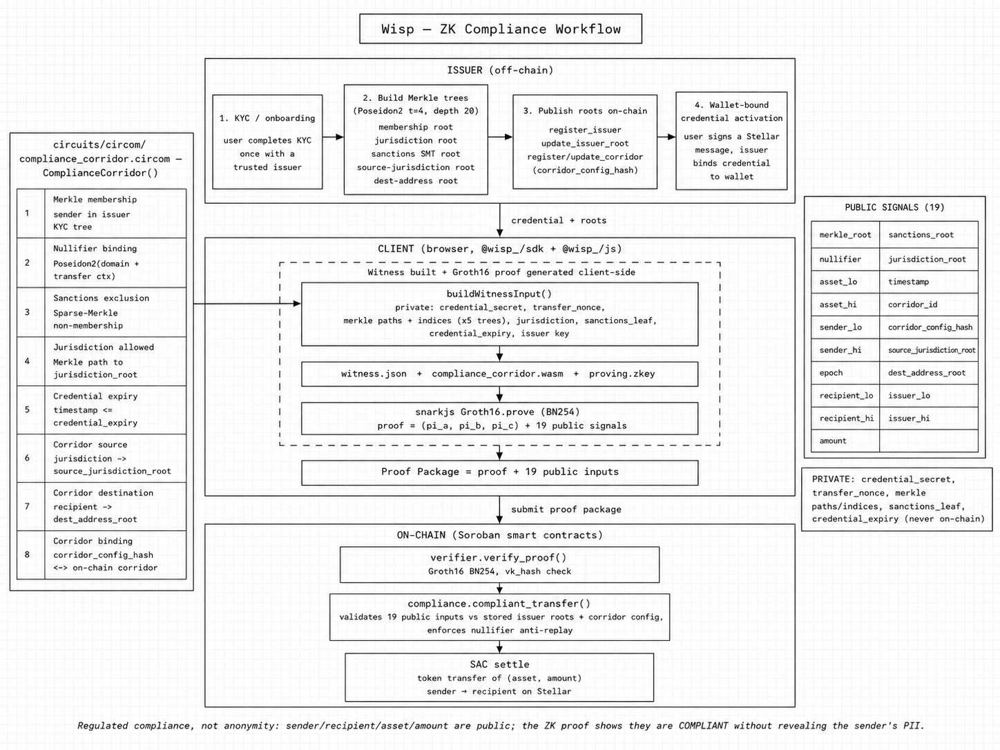

[Live demo](https://wisp-zk.vercel.app/) - [Demo video](https://www.youtube.com/watch?v=jAiUz92IPZQ) - [Super Launch I](https://www.youtube.com/watch?v=p3UdTfTjNd4) - [Super Launch II](https://www.youtube.com/watch?v=tTyu3Z3pJ5o) - [Pitch deck](https://drive.google.com/file/d/1Pz9oVlbFe6Wx1JJngxHkyrusLuk-FOSa/view?usp=sharing)

Verify users once with a trusted issuer, publish compliance roots on-chain, and generate client-side Groth16 proofs per transfer. Soroban verifies the proof, records the nullifier, and gates settlement — no customer documents on-chain.

> Beta / demo release only. The published `@wisp_/*` packages and reference issuer flows are for evaluation and test consumption, not production compliance or production funds movement.

---

## Deployments

| Resource | Value |
| -------- | ----- |
| Frontend | [wisp-zk.vercel.app](https://wisp-zk.vercel.app/) — `/` · `/demo` |
| Issuer API | [wisp-issuer-vekn.onrender.com](https://wisp-issuer-vekn.onrender.com) |
| Network | `Test SDF Network ; September 2015` |
| RPC | `https://soroban-testnet.stellar.org` |
| Explorer | [stellar.expert/testnet](https://stellar.expert/explorer/testnet) |
| Verifier | `CAEJ63XT46UUNCJNZS5IWVLQQSOV3FHCEHJMFJZHAYA4BTBIWQAJKZZ2` |
| Compliance | `CDISQDZ6MUT5KCSP4WRPWJAETN7XA7XOXEL5W2DZ6LZ35USNY3RC6OJN` |
| Circle USDC SAC | `CBIELTK6YBZJU5UP2WWQEUCYKLPU6AUNZ2BQ4WWFEIE3USCIHMXQDAMA` |
| VK hash | `3ea87034b94f427de47c7884cee93c3dea107d579a6b90e04b7343ebac222319` |
| Deploy ledger | `3307817` |

Contract IDs → `.wisp/*.env` · redeploy [`scripts/deploy/`](scripts/deploy/) · config [`frontend/.env.example`](frontend/.env.example)

---

## Packages

Wisp ships as published `@wisp_/*` beta packages (`0.2.1`). Use the umbrella SDK for most integrations, or install individual layers when you need a smaller surface.

| Package | Version | Purpose | README |
| ------- | ------- | ------- | ------ |
| `@wisp_/sdk` | `0.2.1` | Umbrella: prove, settle, audit + subpath re-exports | [`sdk/README.md`](sdk/README.md) |
| `@wisp_/issuer-sdk` | `0.2.1` | Register issuers, manage corridors, publish roots on-chain | [`issuer-sdk/README.md`](issuer-sdk/README.md) |
| `@wisp_/js` | `0.2.1` | Poseidon2, Merkle, nullifier, witness builder | [`packages/wisp-js/README.md`](packages/wisp-js/README.md) |
| `@wisp_/core` | `0.2.1` | Protocol validation, root comparison, shared types | [`packages/wisp-core/README.md`](packages/wisp-core/README.md) |
| `@wisp_/client` | `0.2.1` | Issuer HTTP adapter + chain reads | [`packages/wisp-client/README.md`](packages/wisp-client/README.md) |
| `@wisp_/flows` | `0.2.1` | Client-agnostic prove -> audit -> settle orchestration | [`packages/wisp-flows/README.md`](packages/wisp-flows/README.md) |
| `@wisp_/demo` | `0.2.1` | Demo issuer + mock KYC clients | [`packages/wisp-demo/README.md`](packages/wisp-demo/README.md) |
| `@wisp_/bindings` | `0.2.1` | Canonical proof package + public input ABI | [`bindings/README.md`](bindings/README.md) |
| `@wisp_/compliance` | `0.2.1` | Generated client for the compliance contract | [`bindings/README.md`](bindings/README.md) |
| `@wisp_/verifier` | `0.2.1` | Generated client for the Groth16 verifier contract | [`bindings/README.md`](bindings/README.md) |

Install: `npm install @wisp_/sdk @wisp_/js` · issuer ops: `npm install @wisp_/issuer-sdk` · minimal layers: `npm install @wisp_/core @wisp_/client`

## Examples

Copy-paste, typechecked integration starting points:

| Example | For | Entry |
| ------- | --- | ----- |
| [`examples/quickstart`](examples/quickstart/README.md) | Payer / consumer apps | `@wisp_/sdk/browser` (browser) · `@wisp_/sdk` (Node) |
| [`examples/issuer-quickstart`](examples/issuer-quickstart/README.md) | Issuer operators | `@wisp_/issuer-sdk` (Node) |

## Core Architecture

```
Issuer (off-chain KYC)
  → publishes merkle / sanctions / jurisdiction / corridor roots on-chain
  → wallet signs challenge to derive credentialSecret and activate credential
Browser / Node prover
  → wallet signs proof challenge → issuer returns draft (no nullifier)
  → finalizeProofPackageDraft builds nullifier client-side
  → witness (@wisp_/js) → Groth16 (19 public inputs)
Soroban compliance contract
  → rebinds public inputs → verifies via verifier → nullifier → SAC transfer
```

```
your app / frontend
  ↓
@wisp_/sdk         umbrella: prove · settle · audit
  ├─ @wisp_/core     validation · root compare · types  (no chain deps)
  ├─ @wisp_/client   issuer HTTP adapter · on-chain reads · events
  ├─ @wisp_/flows    prove → audit → settle orchestration
  └─ @wisp_/js       Poseidon2 · Merkle · nullifier · witness
  ↓
issuer-service / @wisp_/issuer-sdk   proof packages · roots · corridors
  ↓
Soroban            verifier (Groth16) → compliance (nullifier + SAC gate)
```

```
wisp/
├── backend/             Soroban contracts + issuer-service
│   └── crates/issuer-core  Internal Rust logic linked by issuer-service (not a public SDK)
├── circuits/circom/     Circom circuit + ceremony
├── bindings/            Canonical ABI + generated clients
├── packages/
│   ├── wisp-js/         crypto primitives
│   ├── wisp-core/       protocol validation + types
│   ├── wisp-client/     issuer + chain transports
│   ├── wisp-flows/      end-user transfer flows
│   └── wisp-demo/       demo issuer + mock KYC
├── sdk/                 @wisp_/sdk umbrella
├── issuer-sdk/          @wisp_/issuer-sdk
├── frontend/            demo UI (workspace-only)
└── scripts/             dev · deploy · ceremony
```

---

## ZK Implementation

**Stack:** Groth16 · BN254 · Poseidon2 t=4 · 20-level Merkle/SMT · **19 public inputs**



Canonical field order: [`bindings/public-inputs.json`](bindings/public-inputs.json) · [`bindings/README.md`](bindings/README.md)

---

## Key Features

- **Portable SDK** — modular `@wisp_/core` · `@wisp_/client` · `@wisp_/flows` packages drop into any issuer or compliance integration; no demo or UI baggage
- **Wallet-bound credential activation** — wallet signs a SEP-10/SEP-53 challenge to derive a unique credential secret and activate an issuer-scoped membership commitment
- **Verify once, prove per transfer** — KYC tree + client-side Groth16; no PII on-chain
- **8-in-1 circuit** — sanctions, jurisdiction, expiry, corridor binding in one proof
- **19 public inputs** — includes `issuer_lo` / `issuer_hi` to bind each proof to the issuing entity
- **Soroban-native verifier** — Groth16 in-contract; nullifier anti-replay
- **Travel-rule corridors** — US→MX and extensible corridor config hashes
- **Full TypeScript stack** — composable `@wisp_/*` packages + `@wisp_/issuer-sdk`
- **Ceremony-ready** — multi-party setup scripts + VK drift checks in CI

---

## Tech Stack

| Layer | Stack |
| ----- | ----- |
| Frontend | Vite 6, React 19, Tailwind 4, framer-motion, GSAP |
| Contracts | Soroban SDK 25, Rust `no_std`, release LTO |
| ZK | Circom 2.2.3, snarkjs, Groth16, BN254, Poseidon2 |
| Backend | Rust issuer-service (Axum) |
| SDKs | `@wisp_/core` · `@wisp_/client` · `@wisp_/flows` · `@wisp_/js` · `@wisp_/sdk` · `@wisp_/issuer-sdk` |
| Settlement | Stellar SAC + `compliant_transfer` |
| Design | Space Grotesk · `#141812` · `#B7E7FF` |

---

## Local Development

**Prerequisites:** Rust 1.94+ · Node 25+ · pnpm · Stellar CLI 25+ · circom 2.2.3 · snarkjs 0.7+ · `cargo install soroban-verifier-gen`

| Command | Description |
| ------- | ----------- |
| `pnpm compile:circuit` | Compile Circom circuit |
| `pnpm setup:circuit` | One-person trusted setup |
| `pnpm build:js` | Build all publishable TypeScript packages |
| `pnpm gen:bindings` | Regenerate ABI bindings |
| `pnpm prove` / `pnpm verify` | Local prove + verify |
| `pnpm dev:frontend` | Demo UI dev server (`/` · `/demo`) |
| `pnpm test:e2e:frontend` | Playwright e2e (demo smoke) |
| `pnpm demo:phase4` | Frontend gate: artifacts + build + e2e |
| `pnpm test:js` | JS test suite |
| `cargo test -p verifier -p compliance` | Contract tests |
| `cargo run -p issuer-service` | Issuer API |
| `./scripts/dev/demo-e2e.sh` | Full local E2E |

---

## Env Setup

Shared deploy state lives in `.wisp/*.env`. SDKs load via `loadWispEnv()`.

**Frontend** — copy [`frontend/.env.example`](frontend/.env.example) → `frontend/.env`:

```bash
VITE_STELLAR_RPC_URL=https://soroban-testnet.stellar.org
VITE_VERIFIER_CONTRACT_ID=
VITE_COMPLIANCE_CONTRACT_ID=
VITE_SAC_CONTRACT_ID=
VITE_ISSUER_PUBLIC_KEY=
VITE_ISSUER_URL=/issuer          # dev proxy → localhost:3000
```

**SDK / scripts** — key vars:

```bash
STELLAR_RPC_URL=...
COMPLIANCE_CONTRACT_ID=...
VERIFIER_CONTRACT_ID=...
SAC_CONTRACT_ID=...
ISSUER_PUBLIC_KEY=...
ISSUER_URL=http://127.0.0.1:3000
KYC_MODE=sep10                 # or mock (local demo only)
WEB_AUTH_DOMAIN=localhost       # SEP-10 auth domain
HORIZON_URL=https://horizon-testnet.stellar.org
WISP_FIXTURE_PROFILE=testnet   # or local; disabled in production
```

**Production mode** — add `ISSUER_MODE=production` and `WISP_FIXTURE_PROFILE=disabled` to disable demo/mock-KYC/temporary-auth routes. Provider webhooks are security-upgraded in production (returns 503).

**Testnet deploy** (funded `amoeba-admin` identity):

```bash
export NETWORK=testnet SOURCE=amoeba-admin
./scripts/deploy/deploy-verifier.sh
./scripts/deploy/deploy-compliance.sh
./scripts/deploy/setup-sac.sh
./scripts/deploy/publish-roots.sh
```

---

## Issuer Setup


**Run locally:**

```bash
export ISSUER_STATE_PATH=.wisp/issuer-state.json
export ISSUER_API_TOKEN=demo-token
export ISSUER_PUBLIC_URL=http://127.0.0.1:3000
export COMPLIANCE_CONTRACT_ID=<from .wisp/compliance.env>
export ISSUER_PUBLIC_KEY=<issuer G-address>
cargo run -p issuer-service
```

**Core issuer endpoints:**

| Method | Path |
| ------ | ---- |
| GET | `/health` |
| GET | `/.well-known/wisp-issuer.json` |
| GET | `/credentials/:wallet` |
| POST | `/credentials/activation-challenges` |
| POST | `/credentials/activate` |
| POST | `/proof-packages/challenges` |
| POST | `/proof-packages` |
| GET | `/corridors` |
| GET | `/corridors/:id` |
| POST | `/admin/roots/publish` (Bearer) |

`HttpIssuerAdapter` uses the well-known + proof-package routes above. `DemoIssuerClient` adds the demo fixture and mock-KYC endpoints for local walkthroughs only. Provider webhooks and SEP-10 auth are **disabled in production mode** (`ISSUER_MODE=production`).

**Publish roots:**

```bash
export ISSUER_API_TOKEN=...
./scripts/dev/publish-roots-via-service.sh
```

**On-chain issuer ops** (register issuer, publish roots via contract): see [`issuer-sdk/README.md`](issuer-sdk/README.md).

Production: set `SUPABASE_DB_URL`, `WISP_ENV=production`, `ISSUER_REQUIRE_DB=1`.

---

## Trust & Security

- **Regulated compliance, not privacy** — parties and amounts are public; proof attests compliance without PII
- **Wallet-bound credential activation** — credential secret derived from wallet signature (SEP-10/SEP-53); commitment binds issuer, sender, jurisdiction, and expiry
- **Challenge-based proof issuance** — wallet must sign per-transfer challenge before issuer releases proof package draft
- **Client-side nullifier** — nullifier computed locally, never transmitted to issuer
- **Nullifier anti-replay** — unique nullifier recorded on-chain per proof
- **VK drift checks** — CI verifies verifier hash matches ceremony artifacts
- **Admin-guarded contracts** — pausable, event-emitting Soroban programs
- **SAC bypass caveat** — direct SAC transfers can bypass Wisp unless issuer authorization is enforced; demo uses approve + `transfer_from`
- **Mainnet ceremony gate** — requires multi-party phase 2 with `published: true` and `verifier_contract_synced: true` in ceremony manifest

Runbooks: [`scripts/deploy/`](scripts/deploy/) · [`scripts/dev/`](scripts/dev/)

---

## Super Launch Trailer

Watch the Wisp Super Launch trailer:

<a href="https://www.youtube.com/watch?v=p3UdTfTjNd4" aria-label="Watch the Wisp Super Launch I trailer on YouTube">
  
</a>
