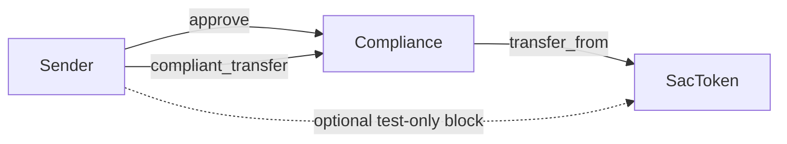
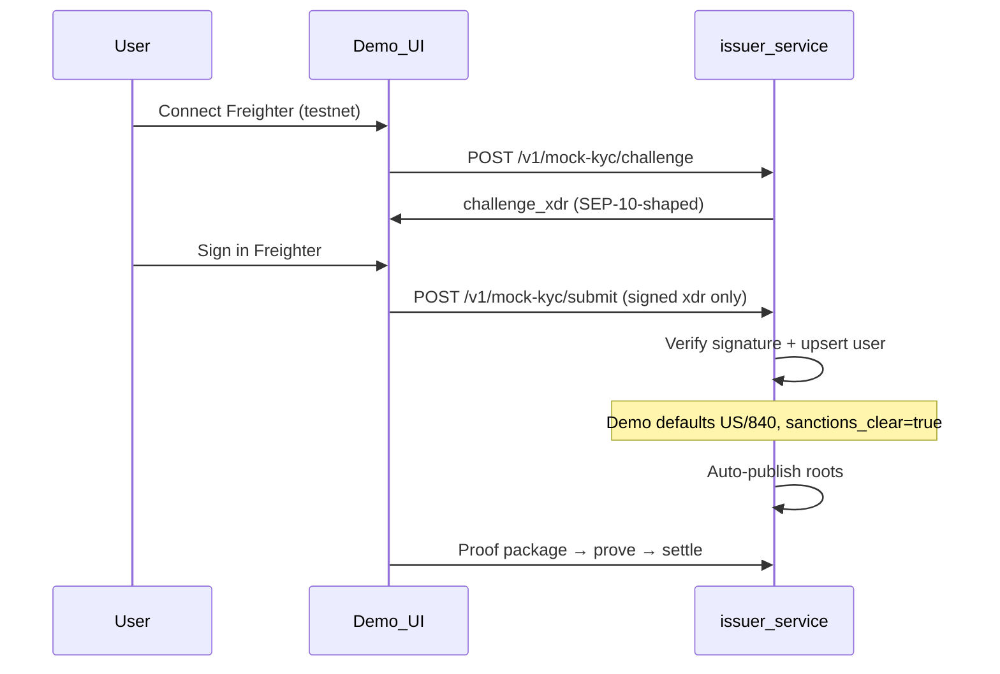

# Amoeba demo gaps — implementation plan

**Moat:** ZK-compliance layer for cross-border Stellar stablecoins.

## Scope locked

| Item | Decision |
|------|----------|
| KYC | **SEP-10 flow** — Freighter on testnet + challenge sign; **no** identity form, **no** SEP-24 anchor |
| KYC API shape | Keep existing `/v1/mock-kyc/*` routes for demo compatibility, but semantics become **wallet auth + demo policy approval**, not form-based KYC |
| Multi-corridor | **Infra only** — fix `corridor_id=1` hardcoding + load corridors from API; no second corridor seed |
| Corridor eligibility | Derive **strictly** from backend-assigned jurisdiction; no per-user corridor override path in demo scope |
| Stablecoin | **Circle testnet USDC** — real issuer asset on Stellar testnet (replace mock SAC for demo settlement) |
| Mainnet ceremony | **Deferred** |

---

## 1. SAC bypass fix (demo enforcement)

**Status:** Implemented — compliance uses `transfer_from`; SDK/UI include approve step.

**Problem:** Users can call SAC `transfer()` directly and skip ZK checks. Circle’s SAC cannot enforce a router policy.

**Approach:** Compliance as spender via `transfer_from` + user **approve** before settle.

| Environment | SAC bypass enforcement |
|-------------|------------------------|
| **Local / CI** | Inline `TestSac` in `compliance/src/test_sac.rs` — optional `enforce_router` blocks direct `transfer()` in unit tests |
| **Testnet (Circle USDC)** | Compliant path via `approve` + `transfer_from`; direct SAC transfer remains possible (production-realistic) |

### Changes (done / maintained)

**Contracts**
- `backend/programs/compliance/src/lib.rs` — `transfer_from(env.current_contract_address(), ...)`
- `backend/programs/compliance/src/test_sac.rs` — inline test token at synthetic `DEMO_ASSET` (replaces `mock-sac` crate)
- `backend/programs/compliance/src/test.rs` — approve in fixtures; router test when `enforce_router` on

**Testnet**
- Circle USDC SAC pinned in `bindings/fixtures/circle-testnet-usdc.json`
- `scripts/deploy/setup-circle-usdc-testnet.sh` + `scripts/dev/check-circle-usdc-testnet.sh`

**SDK + frontend**
- `sdk/src/settle/sac-approve.ts` — SAC `approve(complianceId, amount)` before settle
- Demo UI approve step + `demoLog` allowance errors

**Docs**
- `README.md` — Circle USDC testnet + trustline + funding helper

---

## 2. SEP-10 wallet verification (demo KYC)

**Problem:** Mock KYC collects name/DOB/sanctions — unnecessary friction. SEP-24 is overkill for hackathon demo.

**Approach:** SEP-10 **pattern** on Amoeba issuer: challenge → Freighter sign → approved. No PII form. No anchor popup. Backend assigns a **demo-approved sender profile** after wallet verification. Route names stay under `/v1/mock-kyc/*` for compatibility, but the flow is no longer form-based KYC.

**What the user needs:**

| Requirement | Why |
|-------------|-----|
| Stellar wallet (Freighter) | Prove address ownership (SEP-10) |
| Testnet account | Demo on testnet |
| Test XLM | Sign challenge tx |
| Browser | Demo UI |

**What the user does NOT provide:** name, email, country, DOB, address, ID, bank.

**Demo policy applied after SEP-10 success:**

- `jurisdiction = US`
- `country_numeric = 840`
- `sanctions_clear = true`
- `kyc_mode = sep10`
- `provider = mock`

SEP-10 proves wallet control only. The compliance attributes above are assigned by backend demo policy and must be described that way in product copy and the pitch.

### SEP-10 implementation (demo scope)

| Item | In scope | Out of scope |
|------|----------|--------------|
| Challenge tx + signature verify | Yes | — |
| `{domain} auth` data name + Horizon seq | Nice-to-have upgrade | Full anchor-compatible SEP-10 server |
| `GET /auth?account=G...` | Optional alias of challenge endpoint | `stellar.toml` WEB_AUTH_ENDPOINT |
| Identity fields | No | SEP-24, SEP-12 popup |

### Backend

| File | Work |
|------|------|
| `backend/crates/issuer-service/src/mock_kyc.rs` | Change `MockKycSubmitRequest` to signed challenge only; remove required `name/country/dob/sanctions_clear`; add `kyc_mode` metadata helpers; tighten challenge toward SEP-10 (`WEB_AUTH_DOMAIN`, Horizon seq) |
| `backend/crates/issuer-service/src/state.rs` | Remove `evaluate_mock_kyc_form` from the demo approval path; approve with backend-assigned demo policy: `jurisdiction=US`, `840`, `sanctions_clear=true`, `credential_secret=424242`, `provider=mock`, metadata `kyc_mode: sep10`; persist derived `corridor_eligibility` |
| `backend/crates/issuer-service/src/config.rs` | `WEB_AUTH_DOMAIN`, `HORIZON_URL`, `KYC_MODE=sep10` (default) |
| `backend/crates/issuer-service/src/routes.rs` | Keep `/v1/mock-kyc/*` route names for compatibility; semantics become wallet-auth demo approval; optional `GET /auth` SEP-10 alias; add optional `corridor_id` and `recipient` query support to status |
| `scripts/dev/bru.sh` | Export SEP-10 env vars |

### Frontend + SDK

| File | Work |
|------|------|
| `frontend/src/components/demo/KycOnboardingModal.tsx` | welcome → sign → done (no form step); show “Demo policy: US-approved sender profile after wallet verification” |
| `frontend/src/lib/kyc.ts` | Remove form validators and form state |
| `sdk/src/issuer/client.ts` | `submitMockKyc` request becomes signed challenge only; `getMockKycStatus` accepts optional `corridor_id` and `recipient` query params |
| `frontend/src/content/copy.ts` | "SEP-10 wallet verification" + explicit demo-policy wording |

### Pitch honesty

Demo KYC = **wallet binding via SEP-10**, not production identity. Production: SEP-24 anchor or KYC API webhook.

### Tests

- Submit signature only → approved
- Reject: bad signature, expired challenge, wallet mismatch, replay
- Assert approved metadata includes `kyc_mode=sep10` and backend-assigned jurisdiction/sanctions fields

---

## 3. Multi-corridor infra (no new corridor data)

| Location | Fix |
|----------|-----|
| `state.rs` `corridor_eligibility: [1]` | Replace hardcoded list with derived eligible corridor IDs based on backend-assigned jurisdiction only |
| `state.rs` `ensure_roots_published(cfg, 1)` | Replace hardcoded corridor publish with selected corridor or derived eligible corridors |
| `state.rs` `create_proof_package` | Enforce `req.corridor_id ∈ sender.corridor_eligibility` before destination lookup or proof build |
| `mock_kyc_status` | Optional `?corridor_id=` and `?recipient=`; compute readiness against the requested corridor, not the first enabled corridor |
| `ComplianceHub.tsx` | `GET /v1/corridors` + `GET /v1/corridor/:id` (has `latest_root_snapshot`) |
| `DemoPage.tsx` | Selected `corridor_id` in status + proof package |
| `sdk/src/issuer/client.ts` | Thread selected `corridor_id` and optional `recipient` through status calls |

US→MX only in `bindings/fixtures/demo-users.json`.

**Enforcement rule:** proof creation must fail if the sender is approved but not eligible for the selected corridor. Do not rely on `trees.rs` metadata shaping alone.

**Scope rule:** do not add per-user corridor overrides in metadata for demo scope. If a user is eligible for a corridor, that eligibility must come from the backend-assigned jurisdiction policy only.

---

## 4. Circle testnet USDC (replace mock SAC for demo)

**Status:** Done — pinned in `bindings/fixtures/circle-testnet-usdc.json`; bootstrap guard overwrites stale `sac.env`.

| | Before | Now |
|--|--------|-----|
| Issuer | Deployed mock SAC | Circle `GBBD47IF6LWK7P7MDEVSCWR7DPUWV3NY3DTQEVFL4NAT4AQH3ZLLFLA5` |
| Soroban SAC | `CC7NVAY…` (mock deploy) | `CBIELTK6YBZJU5UP2WWQEUCYKLPU6AUNZ2BQ4WWFEIE3USCIHMXQDAMA` |
| Local CI token | `mock-sac` crate | Inline `test_sac.rs` at synthetic `DEMO_ASSET` |

### Scripts

- `scripts/deploy/setup-circle-usdc-testnet.sh` — trustlines + `.amoeba/sac.env` (`--all-demo-accounts`)
- `scripts/dev/check-circle-usdc-testnet.sh` — trustline + balance gate
- `scripts/dev/bootstrap-testnet-demo.sh` — overwrites sac.env when not Circle ID

### Demo user prerequisites

- Testnet XLM (friendbot)
- **USDC trustline** on sender + recipient
- Sender **pre-funded with testnet USDC** (~1 USDC for default fixture `amount`)

### References

- [Circle trustline quickstart](https://developers.circle.com/stablecoins/quickstart-setup-usdc-trustline-stellar)

---

## 5. Issuer ops — reduce demo friction

| Issue | Fix |
|-------|-----|
| Stale `/v1/roots/publish` | → `/v1/admin/roots/publish` in scripts, demoLog, README, CLAUDE docs, and verification helpers |
| Fetch before ready | Gate on `eligible_for_proof` in DemoPage |
| Custom recipient | `ensure_corridor_destination` in `create_demo_transfer` |
| `missing.destination` too broad | Optional `recipient` query on status |
| Silent publish failures | `publish_warning` in submit/status + toast |
| Bootstrap confusion | Operator checklist in `bru.sh` stdout |

---

## 6. Positioning copy

| Key | Direction |
|-----|-----------|
| `hero.eyebrow` | `ZK-COMPLIANCE FOR CROSS-BORDER STELLAR STABLECOINS` |
| `hero.sub` | Cross-border corridor compliance; credentials off-chain |
| `hero.headlineLead` | Fix typo `infop` → `info` |
| `engine.chapters[2].body` | Gates SAC via compliance contract |
| `demo.kyc` | SEP-10 wallet verification (testnet) |
| `footer.blurb` | ZK-compliance + cross-border |

---

## Implementation order

1. **Issuer ops** — remove stale admin route references and status blind spots
2. **SEP-10 backend contract** — request/response/schema changes first, then frontend/UI
3. **Multi-corridor authorization** — derive eligibility and enforce in `create_proof_package`
4. **SAC bypass** — done (`transfer_from` + approve; inline `test_sac` for CI)
5. **Circle testnet USDC** — done (pinned SAC, bootstrap, funding helper)
6. **Copy** — align demo-policy wording after flow is working

---

## Verification

| Gate | Command |
|------|---------|
| Contract tests | `cargo test -p verifier -p compliance` |
| Issuer tests | `cargo test -p issuer-service` |
| SDK | `pnpm test:sdk` |
| E2E | `bootstrap-testnet-demo.sh` → `check-circle-usdc-testnet.sh` → `bru.sh` → SEP-10 → approve → prove → settle |
| SAC bypass | Inline `test_sac` router test in CI; testnet uses Circle SAC + approve path |
| Corridor auth | Proof request for non-eligible corridor fails before proof build |
| Demo KYC policy | Approved wallet gets backend-assigned demo profile with `kyc_mode=sep10` |

---

## Deferred

- Mainnet ceremony
- Mainnet Circle USDC (same issuer pattern, real money)
- Custom SAC admin on Circle asset (not possible — Circle controls issuer)
- Second corridor seed
- SEP-24 / SEP-12 anchor KYC
- Identity forms / Persona / Sumsub

---

## Todos

- [x] Circle testnet USDC bootstrap + fixture asset IDs
- [x] Resolve and pin Circle testnet USDC SAC contract ID
- [x] SAC bypass contracts + tests (inline test_sac for CI)
- [ ] SAC bypass SDK + DemoPage approve step
- [ ] SEP-10 KYC backend (signed challenge only + challenge hardening + demo policy metadata)
- [ ] SEP-10 KYC frontend (remove form)
- [ ] Multi-corridor infra + proof authorization enforcement
- [ ] Issuer ops fixes + stale route cleanup
- [ ] Positioning copy
